<div align="center">

# 🌾 AgroSuit
### Crop Suitability Intelligence for North Africa

**Which crop belongs where, and why?**
A geospatial decision-support system that combines **ERA5 climate**, **SoilGrids soil** and **Copernicus terrain** data with **FAO fuzzy land evaluation** to rank 13 Mediterranean and Saharan crops for any location, explain what limits each one, and map suitability across whole regions.


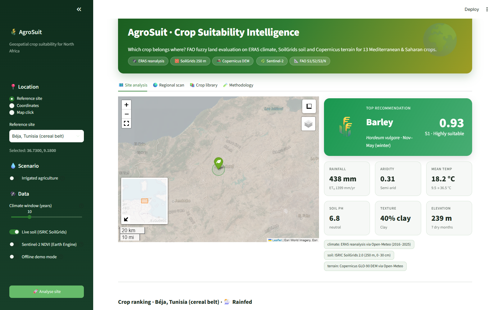

📄 **[Project report (PDF)](docs/AgroSuit_Report.pdf)** · 🎞️ **[Presentation (PowerPoint)](docs/AgroSuit_Presentation.pptx)** · 📓 **[Walkthrough notebook](notebooks/01_suitability_walkthrough.ipynb)**

</div>

---

## 📑 Table of contents

1. [Why this project](#-why-this-project)
2. [Key features](#-key-features)
3. [Project report and presentation](#-project-report-and-presentation)
4. [Screenshots](#-screenshots)
5. [Crops and suitability factors](#-crops-and-suitability-factors)
6. [How it works](#-how-it-works)
7. [Architecture](#-architecture)
8. [Installation](#-installation)
9. [Using the dashboard](#-using-the-dashboard)
10. [Command-line interface](#-command-line-interface)
11. [Python API and notebook](#-python-api-and-notebook)
12. [Outputs and export formats](#-outputs-and-export-formats)
13. [Results on reference sites](#-results-on-reference-sites)
14. [Testing and CI](#-testing-and-ci)
15. [Troubleshooting](#-troubleshooting)
16. [Limitations and roadmap](#-limitations-and-roadmap)
17. [References](#-references)

---

## 🎯 Why this project

North African agriculture runs on a steep gradient: from sub-humid cereal land in northern Tunisia and the Saïss plain (600+ mm of rain) to olive steppes around Sfax (~200 mm) and Saharan oases (< 100 mm). Choosing the wrong crop for a site wastes water, fertiliser and years of investment, especially for tree crops.

AgroSuit answers three questions for any point on the map:

| Question | How AgroSuit answers it |
|---|---|
| **What grows best here?** | Ranks 13 crops with a 0–1 suitability score and an FAO class (S1 / S2 / S3 / N) |
| **Why not the others?** | Shows the *limiting factor* of every crop and the score of each of its 7 factors |
| **What would change it?** | Gives management advice (irrigation deficit in mm, liming or sulfur, frost, heat) and an irrigated scenario |

Everything is built on **free, global, open data** and a **transparent rule-based model**. There is no black box: every number can be traced back to a data source and a crop requirement range.

---

## ✨ Key features

| | Feature | Details |
|---|---|---|
| 🛰️ | **Live open geodata** | Multi-year ERA5 climatology (including FAO-56 reference evapotranspiration), SoilGrids 250 m topsoil, Copernicus GLO-90 elevation, optional Sentinel-2 NDVI / SAVI / NDMI through Google Earth Engine |
| 📐 | **FAO fuzzy land evaluation** | Trapezoidal membership per factor, weighted geometric mean (law of the minimum), centrality bonus, FAO classes S1 / S2 / S3 / N |
| 🧠 | **Explainable results** | Limiting factor per crop, factor-by-factor scores, membership curves showing exactly where the site falls |
| 💡 | **Management advice** | Concrete hints per sub-optimal factor: water deficit in mm/yr, water harvesting (tabias, jessour), liming, sulfur, drainage, frost and heat measures |
| 💧 | **Scenarios** | Rainfed vs irrigated, climate window of 3–30 years |
| 🌍 | **Regional grid scans** | Best crop per cell and per-crop suitability maps for 8 predefined regions, sea cells masked automatically |
| 📊 | **Interactive dashboard** | Satellite basemap with click-to-analyse, KPI cards, ranking bars, factor radar, climograph, water balance, crop library, methodology |
| 💻 | **Command-line tool** | `analyze`, `scan`, `crops`, `app` subcommands with rich terminal output |
| 📤 | **GIS-ready exports** | CSV, GeoJSON (QGIS / ArcGIS), KML (Google Earth), full Markdown report |
| 🔌 | **Resilient** | On-disk API cache, automatic retries and rate-limit back-off, SoilGrids pixel fallback, offline demo mode with 9 reference sites |
| ✅ | **Engineered** | Modular `src/` package, 47 unit tests, Docker, GitHub Actions CI |

---

## 📚 Project report and presentation

Two documents describe the project in depth. Both are in [`docs/`](docs/).

### 📄 [Project report: `docs/AgroSuit_Report.pdf`](docs/AgroSuit_Report.pdf)

An 18-page written report (A4) for supervisors, reviewers and anyone who wants the full story:

| Section | Content |
|---|---|
| Abstract and introduction | Context of North African agriculture, objectives, scope, the 13 crops |
| Data sources | ERA5, SoilGrids 2.0, Copernicus DEM, Sentinel-2: what is used and how it is processed; study-area water gradient |
| Methodology | Feature engineering, fuzzy membership, weighted geometric aggregation, FAO classes, limiting factors and advice, with equations and figures |
| System design | Package structure, design principles, regional scans, quality assurance (47 tests, CI) |
| User interfaces | Annotated dashboard screenshots and CLI |
| Results | Nine reference sites, crop × site suitability heatmap, effect of irrigation, regional patterns |
| Discussion | Limitations, future work, conclusion, references |
| Appendices | Full crop requirement table, commands to run the software |

[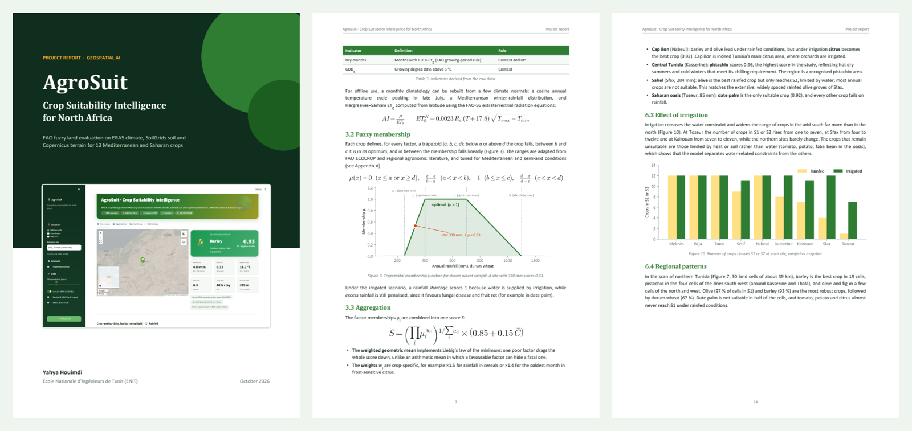](docs/AgroSuit_Report.pdf)

### 🎞️ [Presentation: `docs/AgroSuit_Presentation.pptx`](docs/AgroSuit_Presentation.pptx)

A 15-slide 16:9 deck for a 15–20 minute defence or demo, with **speaker notes on every slide** and native, editable PowerPoint charts:

1. Title · 2. The water gradient problem · 3. Three questions AgroSuit answers · 4. Open data sources · 5. Five-step pipeline · 6. Fuzzy membership · 7. Law of the minimum (worked example) · 8. Explainability · 9. Dashboard · 10. Regional scans · 11. Results table · 12. Effect of irrigation · 13. Engineering quality · 14. Limitations and roadmap · 15. Thank you and how to run it

[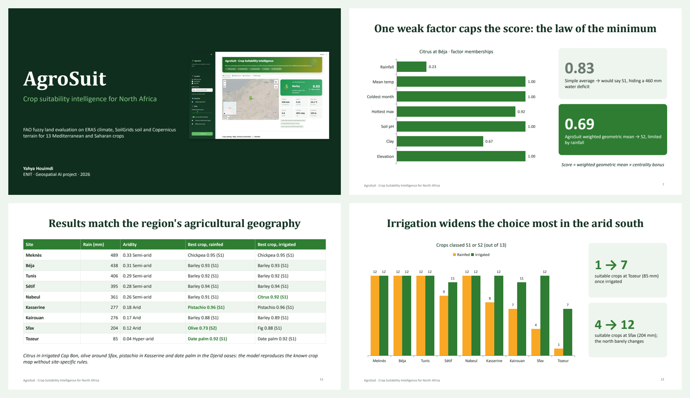](docs/AgroSuit_Presentation.pptx)

---

## 📸 Screenshots

### Home: pick a site
Choose a reference site, type coordinates, or click anywhere on the satellite map. The sidebar controls the scenario (rainfed or irrigated), the climate window and the data sources.

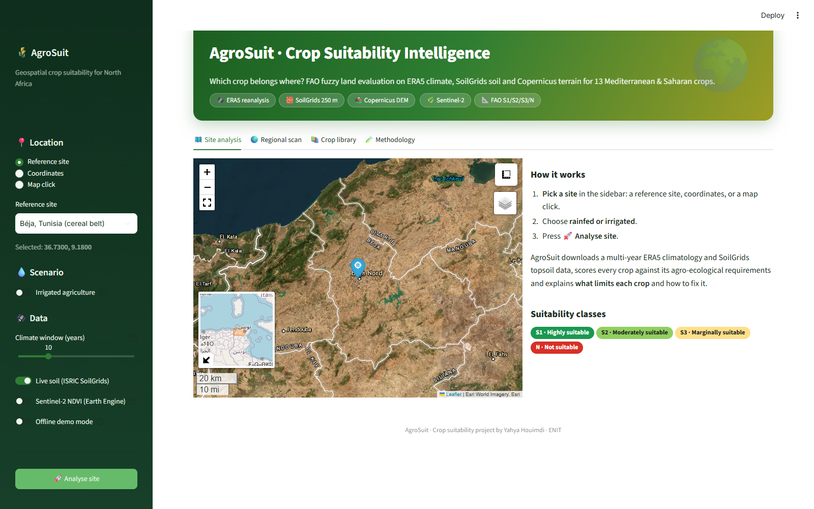

### Site analysis: top recommendation and site profile
After **🚀 Analyse site**, the top crop appears with its score and FAO class, followed by six KPI cards (rainfall and ET₀, aridity class, temperature range, soil pH, texture, elevation) and badges showing which data source fed each layer.


### Crop ranking, factor radar and climate fingerprint
Every crop ranked and coloured by FAO class (dotted lines mark the 0.4 / 0.6 / 0.8 class limits). The radar compares factor profiles; by default it shows the best, a middle and the worst crop. Below, the climograph contrasts monthly rainfall with evaporative demand (ET₀) and the temperature envelope, and the water balance shows the deficit month by month.

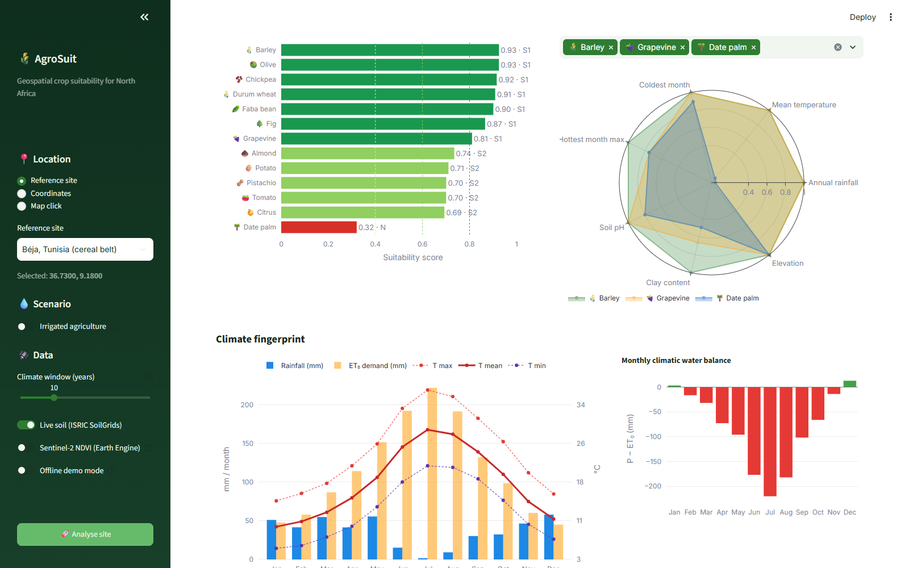

### Why? Limiting factors and management advice
Each crop expands to show its sub-optimal factors, ranked by severity, with an action for each. The membership curves show where the site (orange dot) falls in each crop requirement. In this example citrus at Béja is held back by a ~460 mm/yr water deficit.

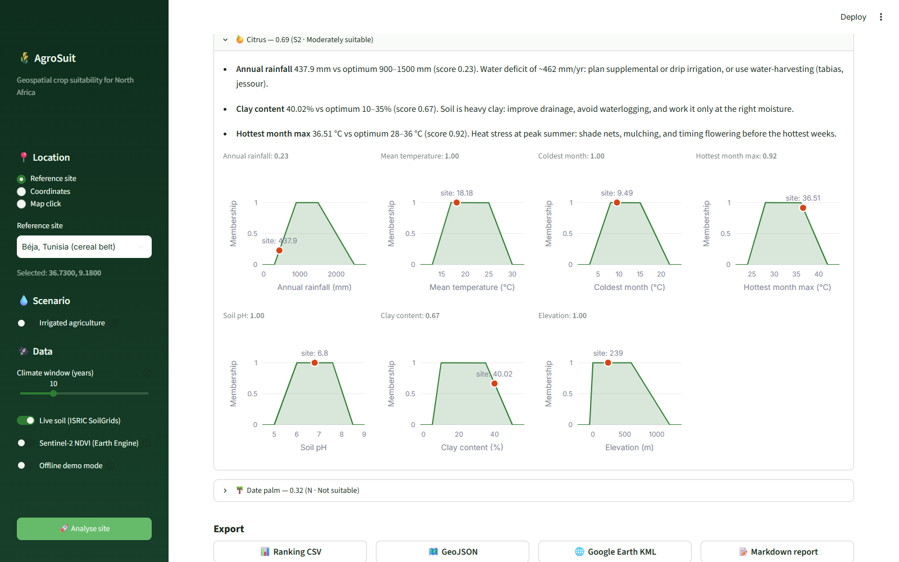

### Regional scan: best crop per cell
Live ERA5 climate and terrain are pulled for a grid over the chosen region, and every crop is scored in every cell. The map shows the winning crop per cell (opacity follows the score). The stacked bars show what share of the land falls in each FAO class for each crop.

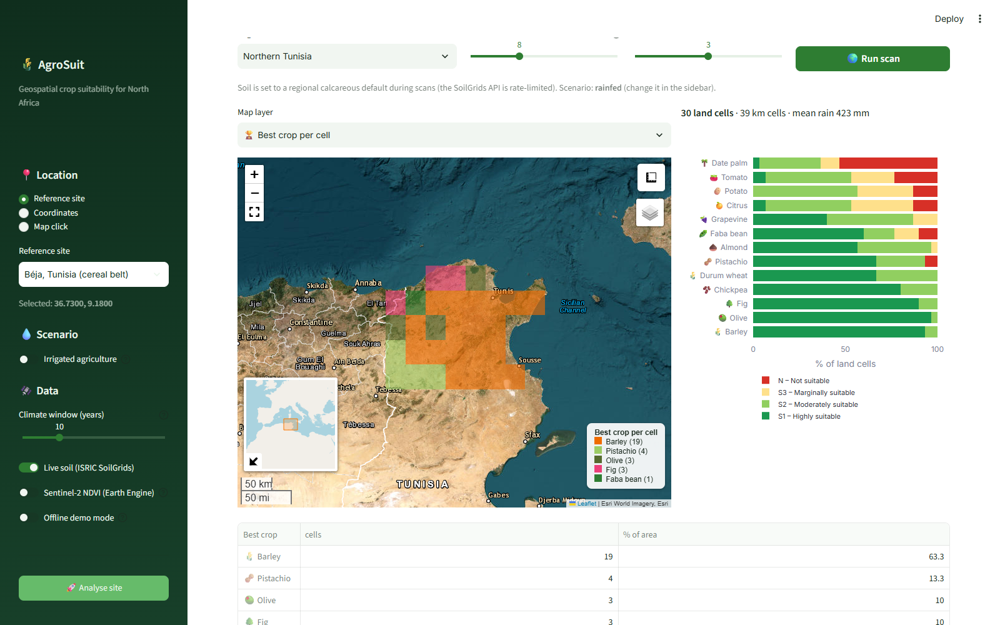

### Regional scan: single-crop suitability map
Switch the map layer to any crop to see its suitability surface on a red → green colour scale.

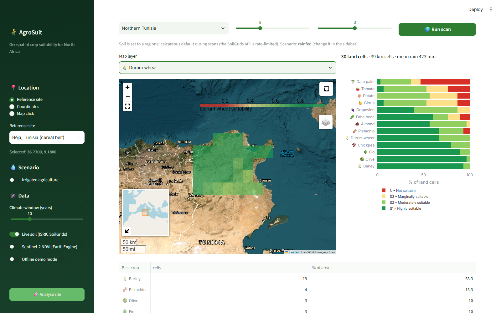

### Irrigated scenario in a Saharan oasis
At Tozeur (85 mm of rain, aridity index 0.04, hyper-arid), date palm is the only highly suitable crop. Switching to irrigation lifts barley, fig, pistachio and olive into class S2, while heat- and soil-sensitive crops stay unsuitable.

| Site profile | Ranking (irrigated) |
|---|---|
| 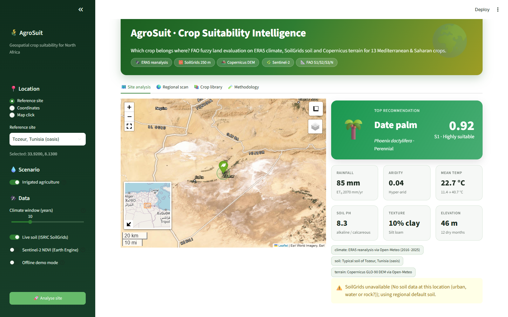 | 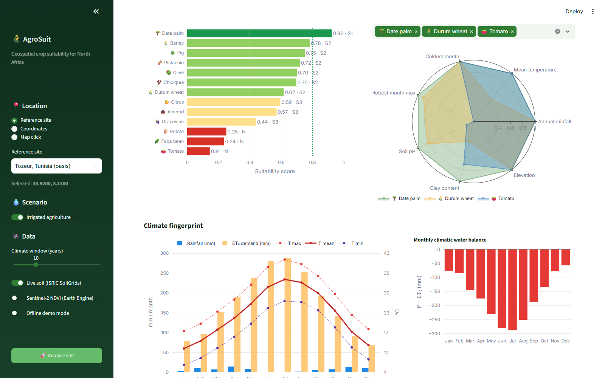 |

### Crop library and methodology
Browse the requirement profile of every crop, with the last analysed site overlaid, and read the full method inside the app.

| Crop library | Methodology |
|---|---|
| 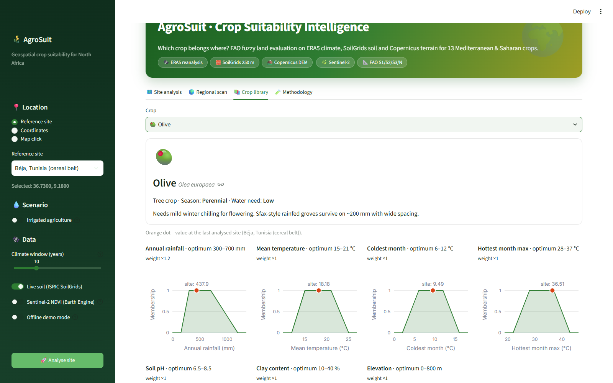 | 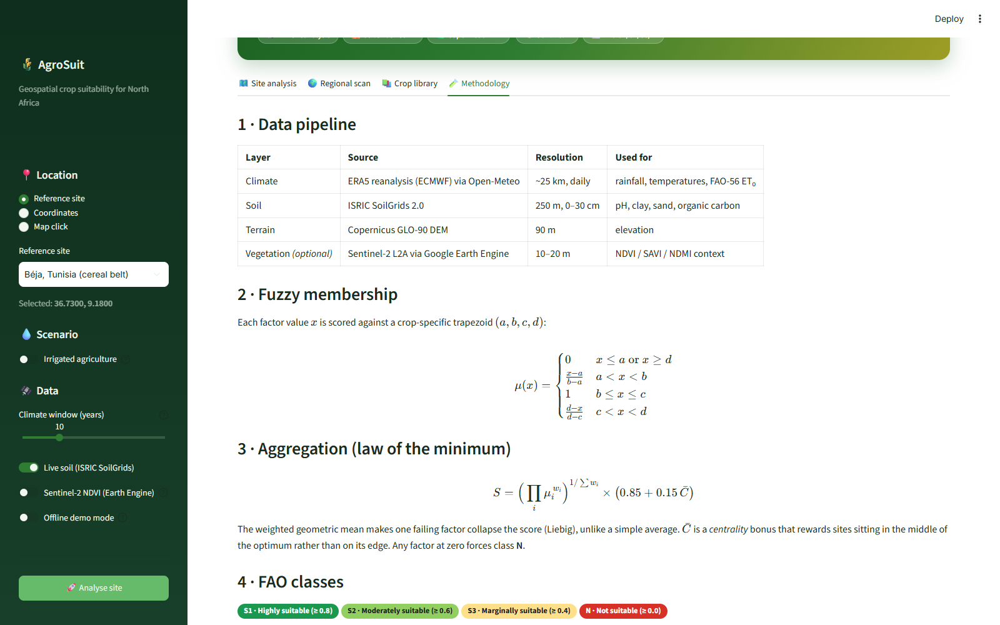 |

### Command line
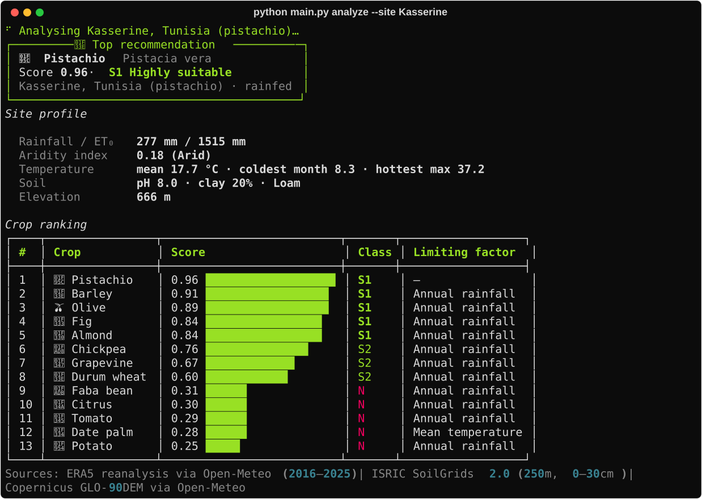

---

## 🌱 Crops and suitability factors

### Crops (13)

| Crop | Scientific name | Type | Season | Water need |
|---|---|---|---|---|
| 🌾 Durum wheat | *Triticum durum* | Cereal | Nov–Jun (winter) | Medium |
| 🌾 Barley | *Hordeum vulgare* | Cereal | Nov–May (winter) | Low |
| 🫒 Olive | *Olea europaea* | Tree crop | Perennial | Low |
| 🌴 Date palm | *Phoenix dactylifera* | Tree crop | Perennial | High (groundwater) |
| 🍊 Citrus | *Citrus sinensis* | Tree crop | Perennial | High |
| 🍇 Grapevine | *Vitis vinifera* | Tree crop | Perennial | Medium |
| 🌰 Almond | *Prunus dulcis* | Tree crop | Perennial | Low–medium |
| 🥜 Pistachio | *Pistacia vera* | Tree crop | Perennial | Low |
| 🌳 Fig | *Ficus carica* | Tree crop | Perennial | Low |
| 🍅 Tomato | *Solanum lycopersicum* | Vegetable | Mar–Sep (open field) | High |
| 🥔 Potato | *Solanum tuberosum* | Vegetable | Spring / autumn | High |
| 🫘 Chickpea | *Cicer arietinum* | Legume | Dec–Jun | Low |
| 🫛 Faba bean | *Vicia faba* | Legume | Nov–May (winter) | Medium |

### Factors (7)

| Factor | Unit | Source | Why it matters |
|---|---|---|---|
| Annual rainfall | mm | ERA5 | Water availability for rainfed crops |
| Mean temperature | °C | ERA5 | Overall thermal regime and season length |
| Coldest month mean | °C | ERA5 | Frost risk, and winter chilling for olive, almond and pistachio |
| Hottest month mean max | °C | ERA5 | Heat stress during flowering and fruit set |
| Soil pH | – | SoilGrids (0–30 cm) | Nutrient availability; calcareous soils are common in the region |
| Clay content | % | SoilGrids (0–30 cm) | Drainage, water holding capacity, workability |
| Elevation | m | Copernicus DEM | Cold nights and a shorter season at altitude |

### Optimal ranges

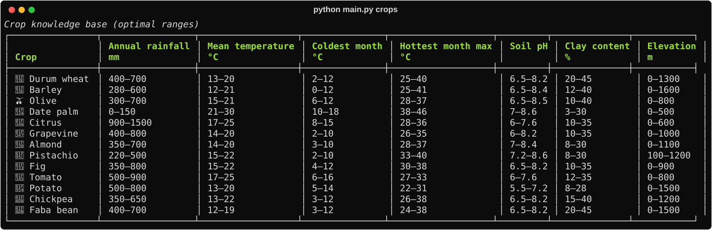

Each range is the optimum (score = 1) of a trapezoid that also has absolute limits (score = 0). See [`src/models/crop_profiles.py`](src/models/crop_profiles.py) for the full `(abs_min, opt_min, opt_max, abs_max)` values and per-factor weights. They are adapted from FAO ECOCROP and regional agronomic literature.

---

## 🔬 How it works

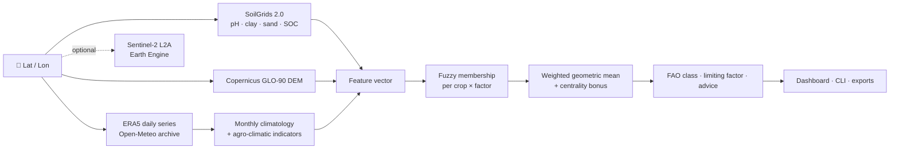

### Step 1: data acquisition

| Layer | What is downloaded | Processing |
|---|---|---|
| **Climate** | Daily `temperature_2m_mean/max/min`, `precipitation_sum` and `et0_fao_evapotranspiration` for *N* full years (default 10, ending 2025) | Monthly totals per year, then averaged across years → a 12-month climatology |
| **Soil** | `phh2o`, `clay`, `sand`, `soc` at 0–5, 5–15 and 15–30 cm | Converted from SoilGrids integer units, then a thickness-weighted 0–30 cm mean. If the pixel is masked (town, road, water), the query retries ~1 km away |
| **Terrain** | Elevation returned with the ERA5 request (Copernicus GLO-90) | Used directly; cells at ≤ 0 m are treated as sea in regional scans |
| **Vegetation** *(optional)* | Sentinel-2 SR Harmonized, Feb–May median, SCL cloud mask, 500 m buffer | Mean NDVI, SAVI, NDMI, shown as context and not scored |

All HTTP responses are cached in `data/raw/cache/`, so a repeated analysis is instant and works without a connection.

### Step 2: feature engineering

From the monthly climatology the following are derived:

| Indicator | Formula | Use |
|---|---|---|
| Annual rainfall | $P = \sum_{m} P_m$ | Scored factor |
| Mean temperature | $\bar T = \frac{1}{12}\sum_m T_m$ | Scored factor |
| Coldest month | $\min_m T_m$ | Scored factor |
| Hottest month max | $\max_m T^{max}_m$ | Scored factor |
| Reference ET₀ | $ET_0 = \sum_m ET_{0,m}$ (FAO-56 Penman-Monteith from ERA5) | Water balance |
| Aridity index | $AI = P / ET_0$, UNEP classes | KPI and context |
| Dry months | months where $P_m < \tfrac12 ET_{0,m}$ (FAO growing-period rule) | KPI |
| Growing degree days | $GDD_5 = \sum_m \max(T_m - 5, 0)\cdot d_m$ | Context |

In **offline mode**, a monthly climatology is rebuilt from a few climate normals: a cosine annual temperature cycle, a Mediterranean winter-rain distribution, and **Hargreaves–Samani ET₀** computed from latitude using the FAO-56 extraterrestrial radiation equations.

### Step 3: fuzzy membership

Each factor value $x$ is scored against the crop's trapezoid $(a, b, c, d)$:

$$
\mu(x)=\begin{cases}
0 & x\le a \ \text{or}\ x\ge d\\[2pt]
\dfrac{x-a}{b-a} & a<x<b\\[6pt]
1 & b\le x\le c\\[2pt]
\dfrac{d-x}{d-c} & c<x<d
\end{cases}
$$

Under the **irrigated scenario**, a rainfall *shortage* scores 1 because water is supplied, but *excess* rain is still penalised (it causes fruit rot in date palm, for example).

### Step 4: aggregation

$$
S=\Big(\prod_i \mu_i^{\,w_i}\Big)^{1/\sum_i w_i}\times\big(0.85+0.15\,\bar C\big)
$$

* The **weighted geometric mean** follows Liebig's law of the minimum: one bad factor drags the whole score down, unlike an arithmetic mean that lets a good factor hide a fatal one.
* $w_i$ are crop-specific weights (for example rainfall ×1.5 for cereals, coldest month ×1.4 for frost-sensitive citrus).
* $\bar C$ is a **centrality** term (1 at the centre of the optimum, 0 at its edges). It separates crops that sit comfortably inside their optimum from crops at its edge, which avoids ties at 1.0.
* If any factor scores 0, the crop is capped at 0.39, so it is always class **N**.

### Step 5: classification and explanation

| Class | Score | Meaning |
|---|---|---|
| 🟢 **S1** | ≥ 0.80 | Highly suitable |
| 🟩 **S2** | 0.60 – 0.80 | Moderately suitable |
| 🟨 **S3** | 0.40 – 0.60 | Marginally suitable |
| 🟥 **N** | < 0.40 | Not suitable |

The factor with the lowest membership is reported as the **limiting factor**. Every factor below 0.98 produces an advice line such as:

> **Annual rainfall** 437.9 mm vs optimum 900–1500 mm (score 0.23). Water deficit of ~462 mm/yr: plan supplemental or drip irrigation, or use water-harvesting (tabias, jessour).

---

## 🏗️ Architecture

```
crop_suitability_yahya/
├── app/
│   └── app.py                    # Streamlit dashboard (4 tabs)
├── main.py                       # CLI: analyze · scan · crops · app
├── src/
│   ├── config.py                 # paths, API endpoints, FAO classes, regions, reference sites
│   ├── http.py                   # requests wrapper: retries, 429 back-off, JSON disk cache
│   ├── pipeline.py               # analyze_site() → SiteReport, scan_region() → grid DataFrame
│   ├── weather/
│   │   └── open_meteo.py         # ERA5 daily → monthly climatology, single and batch
│   ├── soil/
│   │   └── soilgrids.py          # SoilGrids query, depth weighting, USDA texture class
│   ├── satellite/
│   │   ├── indices.py            # NDVI, SAVI, EVI, NDWI, NDMI (scalar or NumPy array)
│   │   └── sentinel2.py          # optional Earth Engine Sentinel-2 sampler
│   ├── preprocessing/
│   │   ├── features.py           # climate features, aridity classes, synthetic climatology
│   │   └── agroclimate.py        # FAO-56 radiation and Hargreaves ET₀
│   ├── models/
│   │   ├── crop_profiles.py      # 13 crop requirement profiles + factor metadata
│   │   └── suitability.py        # trapezoid, scoring, ranking, limiting factor, advice
│   ├── visualization/
│   │   ├── charts.py             # Plotly: ranking, radar, climograph, water balance, curves
│   │   └── maps.py               # Folium: site map, grid maps, legends
│   └── reporting/
│       └── export.py             # GeoJSON, KML, Markdown exporters
├── notebooks/
│   └── 01_suitability_walkthrough.ipynb
├── tests/                        # 47 pytest tests
├── docs/
│   ├── AgroSuit_Report.pdf       # 18-page project report
│   ├── AgroSuit_Presentation.pptx  # 15-slide presentation with speaker notes
│   ├── previews/                 # report and deck previews used in this README
│   └── screenshots/              # dashboard and CLI images used in this README
├── data/raw · data/processed     # API cache and intermediate data (git-ignored)
├── outputs/                      # exported results (git-ignored)
├── .streamlit/config.toml        # dashboard theme
├── Dockerfile · docker-compose.yml
├── .github/workflows/ci.yml      # tests on Python 3.10 and 3.12
├── requirements.txt · pytest.ini · .env.example
└── README.md
```

**Design principles**

* **Separation of concerns:** data access (`weather`, `soil`, `satellite`), processing (`preprocessing`), modelling (`models`) and presentation (`visualization`, `reporting`, `app`) are independent and testable on their own.
* **One pipeline, three front ends:** the dashboard, the CLI and the notebook all call `analyze_site()` and `scan_region()`.
* **Graceful degradation:** every remote source has a fallback (cache → retry → nearby pixel → reference site → regional default), and each report records which source was actually used.

---

## ⚙️ Installation

### Requirements
* Python **3.10+**
* Internet access for live data (optional thanks to offline mode)

### Local setup

```bash
git clone https://github.com/<your-username>/crop_suitability_yahya.git
cd crop_suitability_yahya

python -m venv venv
# Windows
venv\Scripts\activate
# Linux / macOS
source venv/bin/activate

pip install -r requirements.txt
```

### Docker

```bash
docker compose up --build
# → http://localhost:8501
```

`data/` and `outputs/` are mounted as volumes, so the cache and your exports persist between runs.

### Optional: Sentinel-2 through Google Earth Engine

```bash
pip install earthengine-api geemap
earthengine authenticate
cp .env.example .env        # then set EE_PROJECT=<your-cloud-project-id>
```

Then enable **Sentinel-2 NDVI (Earth Engine)** in the sidebar or pass `--satellite` to the CLI. Without it, the rest of the system works unchanged.

---

## 🖥️ Using the dashboard

```bash
streamlit run app/app.py        # or: python main.py app
```

Open <http://localhost:8501>.

| Sidebar control | Effect |
|---|---|
| **Location**: Reference site / Coordinates / Map click | Selects the point to analyse. In *Map click* mode, click on the map in the Site analysis tab |
| **Irrigated agriculture** | Removes rainfall shortage as a constraint |
| **Climate window (years)** | Number of ERA5 years averaged (3–30) |
| **Live soil (ISRIC SoilGrids)** | Off = use the reference-site or regional default soil |
| **Sentinel-2 NDVI (Earth Engine)** | Adds spring vegetation indices (needs Earth Engine) |
| **Offline demo mode** | Uses built-in climate normals; works only near the 9 reference sites |
| **🚀 Analyse site** | Runs the analysis |

| Tab | Content |
|---|---|
| 🗺️ **Site analysis** | Map, top recommendation, KPIs, data sources, ranking, radar, climograph, water balance, per-crop advice and membership curves, export buttons |
| 🌍 **Regional scan** | Region, grid resolution and years → best-crop map, per-crop maps, class distribution, area table, CSV / GeoJSON download |
| 📚 **Crop library** | Crop sheet, requirement curves with the last site overlaid, full requirement table |
| 🧪 **Methodology** | Data sources, equations, classes, indicators, limitations |

**Reference sites:** Béja, Tunis, Nabeul (Cap Bon), Kairouan, Sfax, Kasserine, Tozeur (Tunisia), Meknès (Morocco), Sétif (Algeria).
**Scan regions:** Tunisia, Northern Tunisia, Cap Bon, Sahel & Sfax, Northern Morocco, Saïss Plain, Northern Algeria, Nile Delta.

---

## 💻 Command-line interface

```bash
python main.py <command> [options]
```

| Command | Description |
|---|---|
| `analyze` | Rank all crops for one location |
| `scan` | Grid suitability scan of a region, saved as CSV and GeoJSON |
| `crops` | Print the crop knowledge base |
| `app` | Launch the Streamlit dashboard |

**`analyze` options**

| Option | Default | Description |
|---|---|---|
| `--lat`, `--lon` | – | Coordinates in decimal degrees |
| `--site NAME` | – | Reference site (partial match, e.g. `Sfax`) instead of coordinates |
| `--years N` | 10 | Climate window |
| `--irrigated` | off | Irrigated scenario |
| `--no-soil` | off | Skip SoilGrids |
| `--satellite` | off | Add Sentinel-2 indices (Earth Engine) |
| `--offline` | off | Built-in climate normals |
| `--export DIR` | – | Write CSV, GeoJSON, KML and Markdown report to `DIR` |

**`scan` options**

| Option | Default | Description |
|---|---|---|
| `--region` | `Northern Tunisia` | One of the predefined regions |
| `--resolution` | 8 | Cells along the longest side |
| `--years` | 3 | Climate window |
| `--irrigated` | off | Irrigated scenario |
| `--out` | `outputs/` | Output folder |

**Examples**

```bash
python main.py analyze --lat 36.73 --lon 9.18
python main.py analyze --site Sfax --irrigated --export outputs/
python main.py analyze --site Tozeur --offline
python main.py scan --region "Cap Bon" --resolution 10
python main.py crops
```

---

## 🐍 Python API and notebook

```python
from src.pipeline import analyze_site, scan_region
from src.config import REGIONS
from src.visualization import charts, maps

report = analyze_site(36.73, 9.18, name="Béja", years=10, irrigated=False)

print(report.best.crop.name, report.best.score, report.best.code)   # Barley 0.93 S1
print(report.aridity, report.texture)                                 # Semi-arid Clay
report.ranking_frame()                                                # pandas DataFrame

for hint in report.results[0].advice():
    print(hint)

charts.climograph(report.climatology).show()

df, step = scan_region(REGIONS["Northern Tunisia"], resolution=8, years=3)
maps.scan_map(df, step, layer="best_crop").save("outputs/northern_tunisia.html")
```

The notebook [`notebooks/01_suitability_walkthrough.ipynb`](notebooks/01_suitability_walkthrough.ipynb) walks through the whole pipeline: site analysis, ranking and advice, rainfed vs irrigated, regional scan, and the optional Earth Engine step.

---

## 📤 Outputs and export formats

| Format | Content | Open with |
|---|---|---|
| `*_ranking.csv` | Score, class, limiting factor and per-factor scores for every crop | Excel, pandas |
| `*.geojson` | Point feature with all features, ranking and data sources | QGIS, ArcGIS, geojson.io |
| `*.kml` | Placemark with recommendation and ranking table | Google Earth |
| `*_report.md` | Full report: site profile, ranking, advice for the top 3, warnings, sources | Any Markdown viewer |
| `scan_*.csv` | One row per grid cell: coordinates, climate, all crop scores, best crop | Excel, pandas |
| `scan_*.geojson` | Square polygon per grid cell with the same attributes | QGIS (style by `best_crop` or by crop score) |

---

## 📈 Results on reference sites

Live ERA5 (2016–2025) climate. The soil column shows where SoilGrids returned data and where the typical soil of the site was used.

| Site | Rain (mm) | Aridity | Top crop, rainfed | Top crop, irrigated | Soil |
|---|---|---|---|---|---|
| Meknès (Saïss, Morocco) | 489 | 0.33 Semi-arid | 🫘 Chickpea 0.95 S1 · Olive 0.94 | 🫘 Chickpea 0.95 S1 | SoilGrids |
| Béja (cereal belt) | 438 | 0.31 Semi-arid | 🌾 Barley 0.93 S1 · Olive 0.93 | 🌾 Barley 0.93 S1 | SoilGrids |
| Tunis | 406 | 0.29 Semi-arid | 🌾 Barley 0.92 S1 · Olive 0.91 | 🌾 Barley 0.92 S1 | typical |
| Sétif (high plains, Algeria) | 395 | 0.28 Semi-arid | 🌾 Barley 0.94 S1 · Faba bean 0.91 | 🌾 Barley 0.94 S1 | typical |
| Nabeul (Cap Bon) | 361 | 0.26 Semi-arid | 🌾 Barley 0.91 S1 · Olive 0.91 | 🍊 **Citrus 0.92 S1** | typical |
| Kasserine (pistachio) | 277 | 0.18 Arid | 🥜 **Pistachio 0.96 S1** | 🥜 Pistachio 0.96 S1 | SoilGrids |
| Kairouan | 276 | 0.17 Arid | 🌾 Barley 0.88 S1 · Date palm 0.82 | 🌾 Barley 0.89 · Chickpea 0.86 | typical |
| Sfax (olive groves) | 204 | 0.12 Arid | 🫒 **Olive 0.73 S2** | 🌳 Fig 0.88 · Olive 0.87 | typical |
| Tozeur (oasis) | 85 | 0.04 Hyper-arid | 🌴 **Date palm 0.92 S1** | 🌴 Date palm 0.92 S1 | typical |

The model reproduces the known agricultural geography of the region: cereals and legumes in the sub-humid north, irrigated **citrus in Cap Bon**, rainfed **olive around Sfax**, **pistachio in Kasserine** and **date palm in the Djerid oases**. Irrigation widens the choice most in the arid south: the number of crops in S1 or S2 rises from 1 to 7 at Tozeur and from 4 to 12 at Sfax. These are plausibility checks rather than a formal validation; see the limitations below and section 6 of the [report](docs/AgroSuit_Report.pdf).

---

## ✅ Testing and CI

```bash
pytest -v
```

| Test file | Covers |
|---|---|
| `tests/test_suitability.py` | Trapezoid maths, FAO thresholds, profile validity, S1/N cases, irrigation logic (shortage vs excess), missing factors, ranking order, oasis → date palm, advice text |
| `tests/test_features.py` | NDVI / SAVI / NDWI, extraterrestrial radiation against FAO-56 tables, Hargreaves ET₀ range, synthetic climatology, aridity classes, leap-year-aware monthly aggregation, texture classes |
| `tests/test_pipeline.py` | Offline mode, network-failure fallback, error far from reference sites, live path with mocked APIs, coordinate validation, grid generation, GeoJSON / KML / Markdown validity |

GitHub Actions ([`.github/workflows/ci.yml`](.github/workflows/ci.yml)) runs the suite on Python 3.10 and 3.12, plus an offline CLI smoke test, on every push and pull request.

---

## 🛠️ Troubleshooting

| Symptom | Cause | Fix |
|---|---|---|
| `rate limit reached (HTTP 429)` | Open-Meteo free tier per-minute quota (large scans) | The client already waits and retries; lower the resolution or years, or re-run after a minute: cached cells are not re-downloaded |
| *"SoilGrids unavailable … using regional default soil"* | Pixel masked (town, water, rock) or API down | Automatic fallback; try a point slightly outside the town |
| *"Climate data could not be downloaded and no reference site is close enough"* | No internet, and the point is > 60 km from a reference site | Reconnect, or pick a reference site with **Offline demo mode** |
| Sentinel-2 indices skipped | Earth Engine not installed or authenticated | `pip install earthengine-api`, `earthengine authenticate`, set `EE_PROJECT` |
| Emojis garbled in the Windows terminal | Legacy console code page | Use Windows Terminal, or `set PYTHONIOENCODING=utf-8` |
| Stale results after changing crop profiles | Disk or Streamlit cache | Delete `data/raw/cache/` and press **C** → *Clear cache* in Streamlit |

---

## ⚠️ Limitations and roadmap

**Current limitations**
* Crop requirement ranges are generic (FAO ECOCROP plus literature) and not yet calibrated on local yield data.
* ERA5 (~25 km) smooths rainfall and tends to under-estimate orographic rain in the Tell and Rif mountains.
* Regional scans use a default calcareous soil, because the SoilGrids public API allows ~5 requests per minute.
* Salinity, slope, groundwater depth, irrigation water quality and market access are not modelled.

**Roadmap**
- [ ] Slope and aspect from the DEM as extra factors
- [ ] Soil salinity layer and salt tolerance per crop
- [ ] SoilGrids WCS rasters for spatially explicit soil in regional scans
- [ ] Calibrate ranges with observed land use (Sentinel-2 crop maps, national statistics)
- [ ] Climate-change scenarios (CMIP6 2050 projections) for "future suitability" maps
- [ ] More crops (alfalfa, sorghum, onion, pepper, saffron)

---

## 📚 References

* FAO (1976). *A Framework for Land Evaluation.* FAO Soils Bulletin 32.
* Allen, R. G., Pereira, L. S., Raes, D., Smith, M. (1998). *Crop Evapotranspiration: Guidelines for Computing Crop Water Requirements.* FAO Irrigation and Drainage Paper 56.
* Hargreaves, G. H., Samani, Z. A. (1985). Reference crop evapotranspiration from temperature. *Applied Engineering in Agriculture*, 1(2).
* Hersbach, H. et al. (2020). The ERA5 global reanalysis. *Quarterly Journal of the Royal Meteorological Society*, 146.
* Poggio, L. et al. (2021). SoilGrids 2.0: producing soil information for the globe with quantified spatial uncertainty. *SOIL*, 7.
* UNEP (1997). *World Atlas of Desertification*, 2nd ed.
* FAO ECOCROP database: crop environmental requirements.
* Zadeh, L. A. (1965). Fuzzy sets. *Information and Control*, 8.

---

<div align="center">

**Built by Yahya Houimdi** · ENIT · Geospatial AI project

Data © ECMWF / Copernicus (ERA5), ISRIC (SoilGrids), ESA (Sentinel-2, Copernicus DEM), Open-Meteo.

</div>
